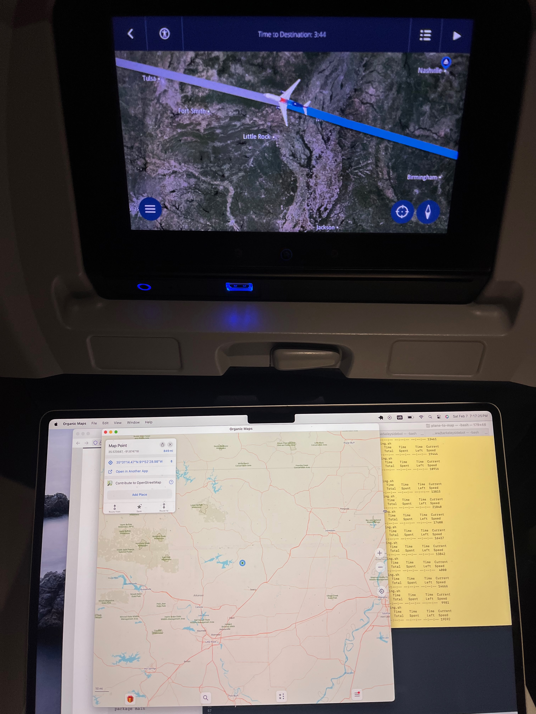

# Plane to Map
Plot your plane's location on a better map!

These scripts talk to the internet equipment built into your airplane -- often giving you the location of your plane even when it can't connect to the internet -- and help you plot it on a high-fidelity map.

## Setup

### On the ground
1. **Download a map app on your Mac**. These scripts will open the location in your default `geo:` opener. I use <a href='https://organicmaps.app/'>Organic Maps</a>, an iPad app that I install via the <a href='https://apps.apple.com/app/organic-maps/id1567437057'>App Store</a>.
2. **Download the maps**. Don't forget to zoom in and download the regions you'll be flying over. In Organic Maps, you simply zoom in until it offers to download the region.
3. **Test**. In your command line, run `open "geo:37.7749,-122.4194?z=7"`. It should open your map provider with a dot in San Francisco.

_Note: you may need to install Python. This uses vanilla Python -- no need for any non-standard libraries._

### In the air
1. **Get on a supported flight!** This code will only run when you're connected to the Wi-Fi on one of the supported airplanes.
2. **Identify the right script**. See the list below.
3. **Run it!** Open this directory in your terminal and run the one-liner from the list below. Re-run the script whenever you want to update the location.

Tips:

* I often use macOS's "tile window full screen" to have both my terminal and Organic Maps in the same full-screen environment.

## Supported planes
There is no universal standard for planes sharing their location with connected devices, so you need to pick the right script for your flight (see the list).

| Airline | Equipment | What to run in the command line |
| -------- | -------- | -------- |
| JetBlue | Viasat (Fly-Fi) | `python3 jetblue-viasat-to-map.py` |
| Delta | "Free Global Wi-Fi" | `./delta-to-map.sh` |
| United | not Starlink | `python3 united-to-map.py` |

### Unsupported planes
Supporting new types of planes is usually pretty straightforward. I'd often pay for the Wi-Fi and reverse engineer the web requests for the map in the browser. When I identified where the current location was available, I'd give that request to Claude and it would write the script.

Selected unsupported flights:

| Airline | Equipment | Status |
| -------- | -------- | -------- |
| American | Panasonic | Supportable: share [this](https://jonlu.ca/posts/aa-tracker) with Claude and ask it to build it |
| Southwest | unknown | Supportable: share [this](https://jamesbvaughan.com/southwest-wifi/) with Claude |
| Delta | Gogo / Paid Wi-Fi (old) | Try `python3 jetblue-viasat-to-map.py`, but don't expect much; it'll be a short flight |
| United | Starlink | Not supported (and not supportable?) |

If you find a new one (especially international airlines!), send a PR and I'll add it!